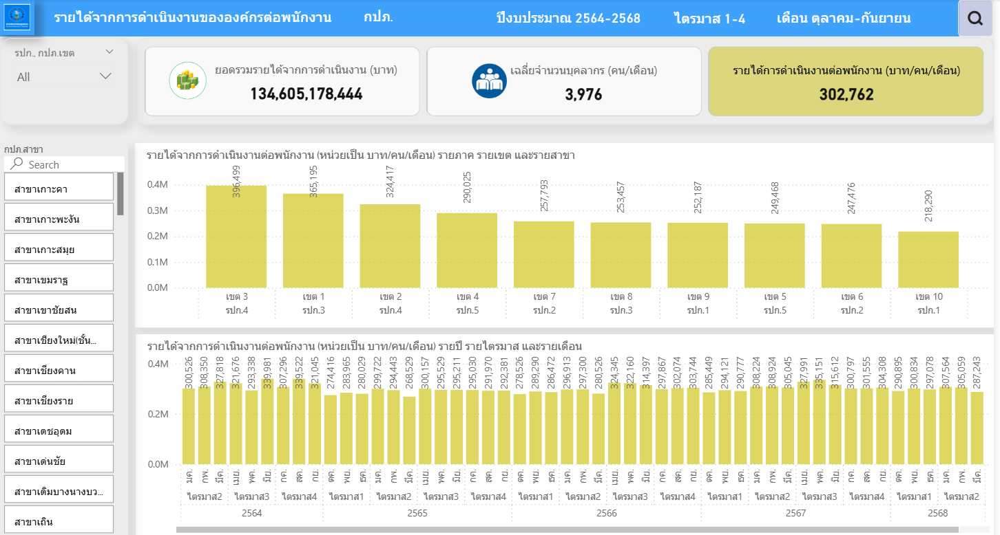
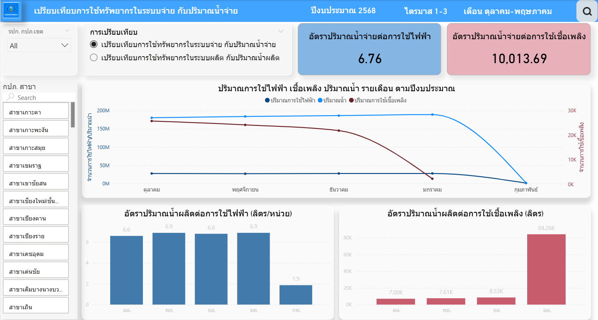
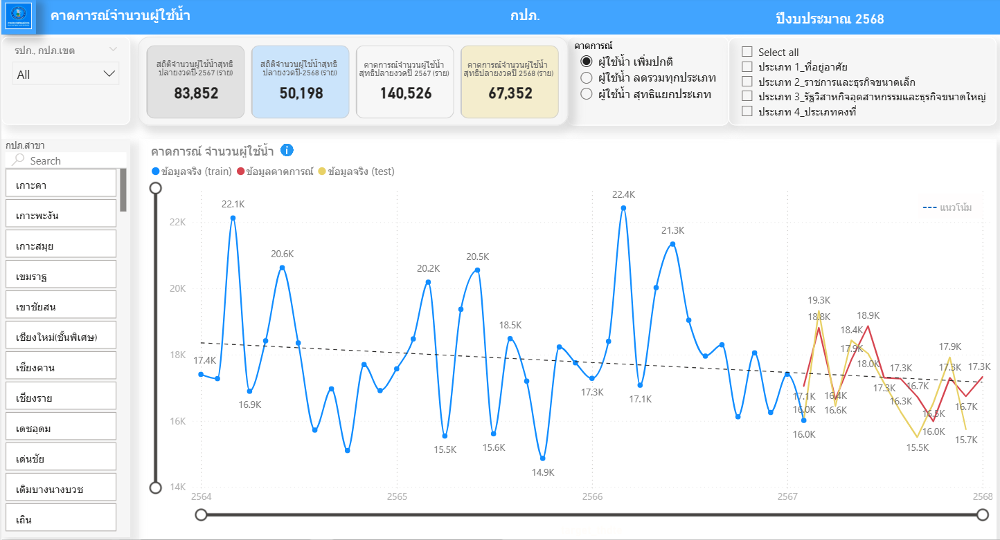
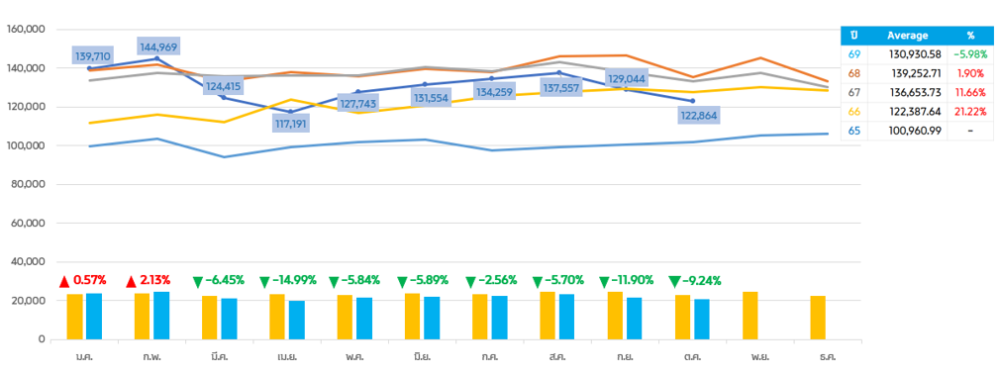

# Hi  My name is Karanyapat Konkaew
===========================================================================================================================================

Data Analyst | Data Scientist | BI | Developer
----------------------------------------------

Data Analyst with 1+ years of experience and a degree in Computational Science. Covers the full analytics cycle: sourcing data from stakeholders, querying with SQL, cleaning with Python and Power Query, Exploratory Data Analysis (EDA), dashboards in Power BI and Tableau, Time Series Forecasting, and root-cause analysis of data anomalies. Delivered work for a financial institution and a state enterprise.

* 🌍  I'm based in Bangkok
* ✉️  You can contact me at [karanyapat.2k@gmail.com](mailto:karanyapat.2k@gmail.com)
* 🧠  I'm currently learning Agentic AI, Open AI

### Socials

 <a href="https://www.github.com/Label-1" target="_blank" rel="noreferrer"> <picture> <source media="(prefers-color-scheme: dark)" srcset="https://raw.githubusercontent.com/danielcranney/readme-generator/main/public/icons/socials/github-dark.svg" /> <source media="(prefers-color-scheme: light)" srcset="https://raw.githubusercontent.com/danielcranney/readme-generator/main/public/icons/socials/github.svg" />  </picture> </a> <a href="https://www.linkedin.com/in/karanyapat-konkaew-6a3b43407/" target="_blank" rel="noreferrer"> <picture> <source media="(prefers-color-scheme: dark)" srcset="https://raw.githubusercontent.com/danielcranney/readme-generator/main/public/icons/socials/linkedin-dark.svg" /> <source media="(prefers-color-scheme: light)" srcset="https://raw.githubusercontent.com/danielcranney/readme-generator/main/public/icons/socials/linkedin.svg" />  </picture> </a>

### Example my work in Data Analyst and Data scientist

##Dashboard สำหรับแสดงรายได้จากการดำเนินงานต่อพนักงาน โดยเปรียบเทียบข้อมูลตามรายภาค รายเขต และรายสาขา รวมถึงมุมมองรายไตรมาสและรายเดือน

##Dashboard เปรียบเทียบปริมาณการใช้ไฟฟ้า น้ำ และเชื้อเพลิง เพื่อช่วยติดตามรูปแบบการใช้ทรัพยากรในแต่ละช่วงเวลา

##Dashboard แสดงข้อมูลจริงและผลการคาดการณ์จำนวนผู้ใช้น้ำ พร้อมเปรียบเทียบแนวโน้มในช่วงเวลาต่าง ๆ

##กราฟเปรียบเทียบปริมาณการใช้น้ำมัน

##Report สรุปข้อเรียนการบริการ

